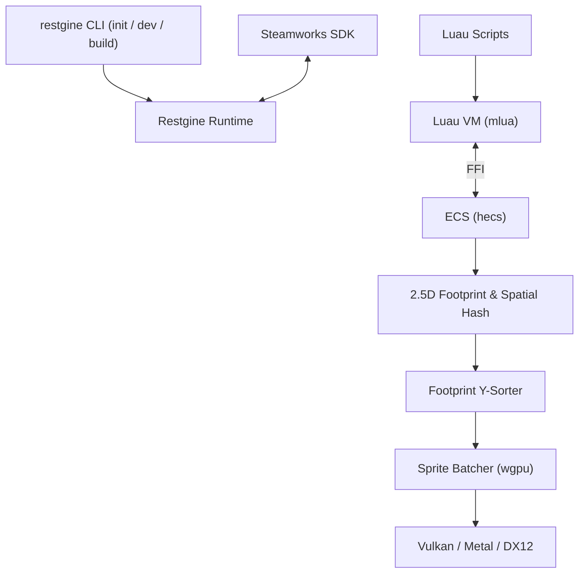

# Restgine

[](https://github.com/PilohWhy/restgine/actions/workflows/ci.yml)
[](LICENSE-MIT)
[](https://www.rust-lang.org)
[](https://luau.org)
[](https://store.steampowered.com/steamdeck)

Restgine is a code-first 2D isometric and 2.5D pixel art engine targeting Steam and the Steam Deck. The core is written in Rust using `wgpu` and `hecs`, while gameplay logic is scripted in Luau.

There is no graphical editor window. You write scripts in your text editor with Luau LSP type definitions, edit levels in LDtk or Tiled, draw sprites in Aseprite, and run the project through the `restgine` CLI.

## Features

- **2.5D depth sorting**: Uses the spatial model from *The Binding of Isaac*. Entities share a ground plane `(x, y)` with an elevation offset `z` for jumping and projectiles. Sorting uses ground footprint `y` so sprites overlap correctly.
- **Responsive pixel scaling**: Automatically scales the canvas by whole integers and widens the visible world to match 16:10 (Steam Deck), 16:9, or 21:9 displays instead of letterboxing.
- **Steamworks integration**: Steam Input, Cloud Saves (`ISteamRemoteStorage`), achievements, and Steam Deck detection are built into the engine runtime.
- **Live hot reload**: Changing `.luau` files or art assets updates the running game without restarting.
- **Standalone CLI tool**: `restgine` handles project setup, local testing, and packing assets into a `.pak` archive for Steam releases.

## Architecture



## Quick Start

### 1. Install CLI

```bash
cargo install --path crates/restgine_cli
```

### 2. Create a project

```bash
restgine init my_game
cd my_game
```

Project layout:
```
my_game/
├── game.toml              # Window, resolution, and Steam AppID
├── assets/
│   ├── sprites/
│   └── audio/
└── scripts/
    ├── main.luau          # Game entry point
    └── restgine.d.luau    # Luau LSP autocompletion
```

### 3. Run development build

```bash
restgine dev
```

Edits to `scripts/` or `assets/` hot-reload while the game runs.

### 4. Build for release

```bash
restgine build --release
```

Packs files into `dist/game.pak` alongside the binary and Steam libraries.

## Gameplay Example

A basic character controller with 2.5D movement and projectile firing in `scripts/main.luau`:

```luau
--!strict
local player = nil
local shoot_cooldown = 0

function init()
    player = restgine:spawn({
        x = 0,
        y = 0,
        z = 0,
        radius = 8,
        z_height = 16,
        is_solid = true,
        layer = "ground_entities"
    })
    restgine:unlock_achievement("START_GAME")
end

function update(dt: number)
    if not player then return end

    local mx, my = restgine:get_vector("a", "d", "w", "s")
    restgine:set_velocity(player, mx * 130, my * 130, 0)

    local px, py, _ = restgine:get_position(player)
    restgine:set_camera_position(px, py)

    shoot_cooldown -= dt
    local sx, sy = restgine:get_vector("left", "right", "up", "down")
    if (sx ~= 0 or sy ~= 0) and shoot_cooldown <= 0 then
        shoot_cooldown = 0.2
        restgine:play_sound("assets/audio/shoot.wav", 0.7, 1.0)
        
        local tear = restgine:spawn({
            x = px,
            y = py,
            z = 8,
            radius = 4,
            z_height = 6,
            is_solid = false,
            layer = "airborne"
        })
        restgine:set_velocity(tear, sx * 250, sy * 250, 15)
    end
end
```

## Workspace Crates

```
crates/
├── restgine_core/       # Timestep clock, input, and configuration
├── restgine_ecs/        # 2.5D components (Transform, Sprite, Footprint)
├── restgine_physics/    # Footprint collisions and spatial hash grid
├── restgine_render/     # wgpu pipeline, Y-sorting batcher, pixel camera
├── restgine_audio/      # Spatial audio playback and sample cache
├── restgine_assets/     # Aseprite loader, atlas builder, and .pak packer
├── restgine_steam/      # Steamworks SDK and Steam Deck detection
├── restgine_luau/       # Luau runtime, bindings, and type definition generator
└── restgine_cli/        # CLI tool (`init`, `dev`, `build`)
```

## License

Dual-licensed under [MIT](LICENSE-MIT) or [Apache-2.0](LICENSE-APACHE).
