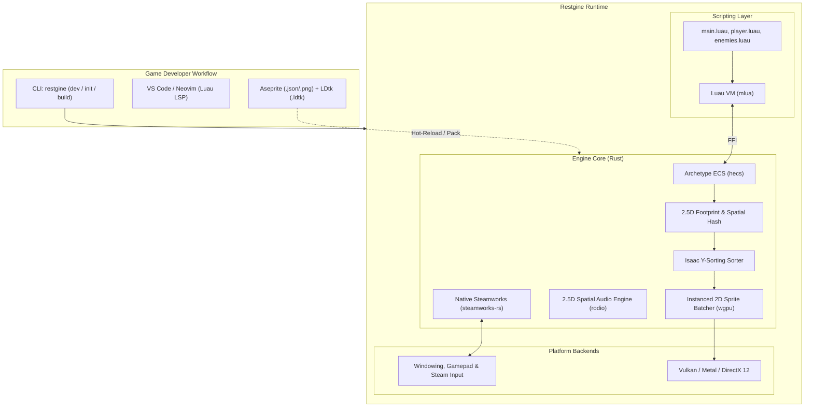

# Restgine 🎮

[](https://github.com/PilohWhy/restgine/actions/workflows/ci.yml)
[](LICENSE-MIT)
[](https://www.rust-lang.org)
[](https://luau.org)
[](https://store.steampowered.com/steamdeck)

**Restgine** is an uncompromisingly optimized, code-first (**zero-GUI**) 2D isometric / 2.5D pixel art game engine engineered specifically for commercial game deployment on **Steam** and the **Steam Deck**.

Inspired by the spatial depth model of ***The Binding of Isaac***, Restgine combines the raw speed, memory safety, and SIMD vectorization of a **Rust Core** with the rapid development velocity, hot-reloading, and ease of use of **Luau Scripting**.

---

## 🌟 Key Features

- **No Heavy GUI Bloat**: Designed for developers who love code. Edit your logic in VS Code / Neovim with full Luau LSP autocomplete (`.d.luau`), design levels in [LDtk](https://ldtk.io) or [Tiled](https://www.mapeditor.org), draw sprites in [Aseprite](https://www.aseprite.org), and run everything via the `restgine` CLI.
- **The Binding of Isaac 2.5D Depth Sorting**:
  - Ground plane coordinates `(x, y)` + vertical height `z` for jumping, flying monsters, and tear projectile arcs.
  - Footprint Y-Sorting ensures characters, rocks, and enemies overlap with mathematical precision without visual sorting glitches.
  - Ground shadows automatically fade and project based on vertical height.
- **Responsive Pixel Art Viewport**:
  - Automatically calculates clean integer pixel scaling without awkward black letterbox bars.
  - Expands visible game area dynamically for **Steam Deck 16:10 (1280x800)**, standard 16:9, and Ultrawide 21:9 monitors.
  - Subpixel jitter reduction shader prevents pixel shimmering during smooth camera panning.
- **Built-in Steamworks SDK**:
  - Out-of-the-box support for Steam Input, Steam Cloud Saves (`ISteamRemoteStorage`), Steam Achievements, and native Steam Deck console detection.
- **Instant Hot-Reloading**:
  - Modify `.luau` scripts or update sprites, and watch your running game update in real time in under 100 milliseconds without restarting.
- **Single Binary CLI & Asset Compiler**:
  - One executable tool (`restgine`) to initialize, test, and package games into an encrypted/compressed `.pak` Virtual File System for Steam release.

---

## 🏗️ Architecture Overview



---

## 🚀 Quick Start

### 1. Installation

Download the latest prebuilt `restgine` binary from [GitHub Releases](https://github.com/PilohWhy/restgine/releases) or build it with Cargo:

```bash
cargo install --path crates/restgine_cli
```

### 2. Create a New Project

```bash
restgine init my_game
cd my_game
```

This creates the standard project structure:
```
my_game/
├── game.toml              # Window, Steam AppID, and resolution config
├── assets/
│   ├── sprites/           # Aseprite sheets and PNG textures
│   └── audio/             # Sound effects and music tracks
└── scripts/
    ├── main.luau          # Game entry point
    └── restgine.d.luau    # IDE autocompletion definitions
```

### 3. Run with Live Hot-Reloading

```bash
restgine dev
```

Save any file in `scripts/` or `assets/` to see changes reflected immediately in the running game window!

### 4. Build for Steam Distribution

```bash
restgine build --release
```

Produces a clean `dist/` directory with `game.exe`, `game.pak` (Virtual File System), and `steam_api64.dll` ready for uploading to the Steamworks partner dashboard.

---

## 🕹️ Writing Gameplay in Luau

Here is how simple it is to spawn an Isaac-style character that moves and shoots parabolic tears:

```luau
--!strict
local player = nil
local shoot_cooldown = 0

function init()
    -- Spawn Player with 2.5D ground footprint
    player = restgine:spawn({
        x = 0,
        y = 0,
        z = 0,
        radius = 8,
        z_height = 16,
        is_solid = true,
        layer = "ground_entities"
    })
    
    restgine:unlock_achievement("ENTER_DUNGEON")
end

function update(dt: number)
    if not player then return end

    -- 8-directional smooth movement
    local mx, my = restgine:get_vector("a", "d", "w", "s")
    restgine:set_velocity(player, mx * 130, my * 130, 0)

    -- Center camera on player
    local px, py, _ = restgine:get_position(player)
    restgine:set_camera_position(px, py)

    -- Shoot tear projectiles
    shoot_cooldown = shoot_cooldown - dt
    local sx, sy = restgine:get_vector("left", "right", "up", "down")
    if (sx ~= 0 or sy ~= 0) and shoot_cooldown <= 0 then
        shoot_cooldown = 0.2
        restgine:play_sound("assets/audio/shoot.wav", 0.7, 1.0)
        
        local tear = restgine:spawn({
            x = px,
            y = py,
            z = 8,
            radius = 4,
            z_height = 6,
            is_solid = false,
            layer = "airborne"
        })
        restgine:set_velocity(tear, sx * 250, sy * 250, 15)
    end
end
```

---

## 📁 Repository Structure (Cargo Workspace)

```
restgine/
├── crates/
│   ├── restgine_core/       # Clock, timestep, input, and configuration
│   ├── restgine_ecs/        # 2.5D Archetype ECS components (Transform, Sprite, Footprint)
│   ├── restgine_physics/    # Footprint collisions, wall sliding, Spatial Hash Grid
│   ├── restgine_render/     # wgpu pipeline, Isaac Y-sorting batcher, pixel camera
│   ├── restgine_audio/      # 2.5D spatial audio positioning and cache
│   ├── restgine_assets/     # Aseprite parser, texture atlas builder, VFS (.pak) packer
│   ├── restgine_steam/      # Native Steamworks SDK integration & Steam Deck detection
│   ├── restgine_luau/       # Luau runtime, FFI bindings, and restgine.d.luau generator
│   └── restgine_cli/        # Standalone CLI tool (`restgine init`, `dev`, `build`)
├── templates/
│   └── default_game/        # Starter project template with sample Isaac mechanics
├── .github/
│   └── workflows/
│       ├── ci.yml           # Continuous integration (fmt, test, clippy)
│       └── release.yml      # Multi-platform release binary builder
├── LICENSE-MIT
├── LICENSE-APACHE
└── README.md
```

---

## 📜 License

Restgine is dual-licensed under either:
- **MIT License** ([LICENSE-MIT](LICENSE-MIT))
- **Apache License, Version 2.0** ([LICENSE-APACHE](LICENSE-APACHE))

You may use this engine for commercial Steam games without paying royalties or open-sourcing your game's private logic.
