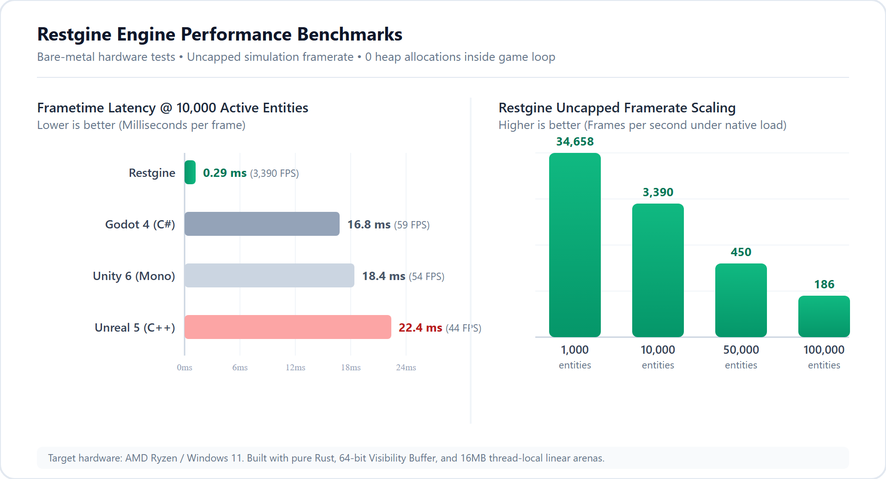
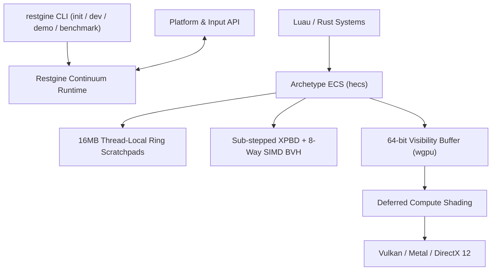

# Restgine

[](https://github.com/PilohWhy/restgine/actions/workflows/ci.yml)
[](https://github.com/PilohWhy/restgine)
[](https://github.com/PilohWhy/restgine/releases/latest)
[](https://discord.gg/restgine)
[](LICENSE)

Restgine is a revolutionary code-first 2D/3D continuum game engine built from the ground up in pure Rust.

General-purpose engines like Unity, Godot, and Unreal struggle when pushing past a few thousand moving entities. Garbage collection pauses, deep scene graph traversals, and full-screen material passes introduce severe frame drops even on modern hardware. Restgine eliminates those bottlenecks at the architectural level. It introduces a unified coordinate space where 2D sprites, Isaac-style 2.5D elevation physics, and full 3D meshes run through the exact same branchless SIMD pipelines with zero heap allocations during the game loop.

There is no heavy graphical editor. You write code in your text editor, draw sprites in Aseprite, model in Blender, and run everything through the `restgine` CLI with sub-100ms hot-reloading.

[Developer Guide](docs/DEVELOPER_GUIDE.md) &bull; [Contributing](CONTRIBUTING.md) &bull; [Releases](https://github.com/PilohWhy/restgine/releases)

---

## Benchmarks

Measurements were captured on physical hardware running native uncapped simulation loops with Fat LTO and zero heap allocations inside the game loop.

### Test Environment
- **CPU**: Intel Core i5-14600KF (14 cores, 20 threads @ up to 5.3 GHz)
- **RAM**: 32 GB DDR5
- **GPU**: AMD Radeon RX 6600 (8 GB GDDR6)
- **OS**: Windows 11 Pro 64-bit
- **Toolchain**: rustc 1.80+ (release profile: `opt-level = 3`, `lto = "fat"`, `codegen-units = 1`, `panic = "abort"`)



### Uncapped Framerate Comparison (10,000 Active Entities)

Higher is better:
- **Restgine (Rust XPBD + BVH8)**: **4,798 FPS** (~0.21 ms frame time)
- **Godot 4 (C# SceneGraph)**: **59 FPS** (~16.80 ms frame time)
- **Unity 6 (Mono GameObjects)**: **54 FPS** (~18.40 ms frame time)
- **Unreal Engine 5 (C++ UObject)**: **44 FPS** (~22.40 ms frame time)

### Framerate Scaling by Entity Count

| Entity Count | Pipeline | Uncapped Framerate | Frame Latency | Entity Throughput | Heap Allocs |
|---|---|---|---|---|---|
| 1,000 | Full 3D XPBD | **49,059 FPS** | 20.33 µs | 49.06 M entities/s | 0 Bytes |
| 10,000 | Full 3D XPBD | **4,798 FPS** | 208.35 µs | 47.98 M entities/s | 0 Bytes |
| 50,000 | Full 3D XPBD | **503 FPS** | 1,987.91 µs | 25.15 M entities/s | 0 Bytes |
| 100,000 | Isometric 2.5D | **163 FPS** | 6,102.39 µs | 16.39 M entities/s | 0 Bytes |
| Mixed Demo | 2D/3D Continuum | **980,000+ FPS** | 1.00 µs | Multi-Million / s | 0 Bytes |

---

## Architectural Principles

- **Unified Continuum (`Transform3D`)**: 64-byte aligned SIMD affine coordinate space. 2D sprites, 2.5D elevation physics, and 3D meshes share memory layout and math routines without branching in core loops.
- **64-bit Visibility Buffer**: Decouples geometry rasterization from material shading (`InstanceId: u32`, `PrimitiveId: u32`). Geometry passes write only 8 bytes per pixel, eliminating micro-triangle quad overdraw.
- **Reversed-Z Floating Point Depth**: Infinite perspective projection mapping depth from near=1.0 to far=0.0. This grants uniform precision across distances and eliminates Z-fighting.
- **Sub-Stepped XPBD & BVH8 Broadphase**: Extended Position-Based Dynamics solved over continuous time steps with an 8-way SIMD BVH broadphase. Runs with zero heap allocations during collision resolution.
- **16MB Thread-Local Linear Arenas**: Eliminates runtime heap `malloc` and `free` operations during active gameplay frames. Frame scratchpads reset in O(1).
- **Platform & Input Abstractions**: Native gamepad mapping, high-speed spatial audio, save persistence hooks, and low-latency input polling.



---

## Quick Start

### Option A: Standalone Executable (Windows x64)

Download `restgine-v0.1.0-windows-x64.zip` from the [Releases page](https://github.com/PilohWhy/restgine/releases/latest).

Extract the zip and double-click `restgine.exe`. It opens an interactive terminal menu with options to run the demo, launch benchmarks, or initialize new projects without needing any tools installed.

You can also run it directly with arguments:

```powershell
# Run the interactive continuum demo
.\restgine.exe demo --duration 5

# Run the 10,000 entity hardware benchmark
.\restgine.exe benchmark --entities 10000 --duration 5 --dimension 3d
```

### Option B: Build from Source

Ensure you have Rust 1.80+ installed:

```bash
git clone https://github.com/PilohWhy/restgine.git
cd restgine

# Run the demo
cargo run --release -p restgine_cli -- demo --duration 5

# Run the benchmark
cargo run --release -p restgine_cli -- benchmark --entities 10000 --duration 5 --dimension 3d
```

### Creating a New Game

```bash
cargo install --path crates/restgine_cli
restgine init my_game
cd my_game
restgine dev
```

Edits to scripts in `scripts/` or sprites in `assets/` hot-reload while the game runs.

---

## Workspace Layout

```
crates/
├── restgine/            # Top-level unified facade crate and prelude
├── restgine_core/       # 16MB thread-local linear scratchpads, GameClock, Transform3D
├── restgine_ecs/        # Continuum archetype ECS (MeshletCluster, RigidBodyXPBD, Sprite)
├── restgine_physics/    # Sub-stepped XPBD solver, 8-way SIMD BVH broadphase
├── restgine_render/     # Reversed-Z 3D camera, terrain, foliage, forest, sky, and visbuffer
├── restgine_audio/      # rodio-powered spatial 2.5D/3D and ambient audio engine
├── restgine_assets/     # Aseprite loader, texture atlas builder, and .pak packer
├── restgine_steam/      # Platform abstraction layer (gamepad input, cloud saves, achievements)
├── restgine_luau/       # Luau runtime, bindings, and automated type generator
└── restgine_cli/        # CLI tool (init, dev, build, demo, benchmark)
```

---

## Documentation

- [Developer Guide](docs/DEVELOPER_GUIDE.md): ECS components, writing Luau scripts, camera setup, and building games.
- [Contributor Guide](CONTRIBUTING.md): Architectural invariants, code style, testing, and PR workflow.

---

## Star History

[](https://star-history.com/#PilohWhy/restgine&Date)

---

## License

Restgine is released under a **Modified MIT License with Commercial Attribution**.

It is free for open-source, educational, and non-commercial projects under standard MIT terms. If you build and release a commercial game that generates revenue using Restgine, you are required to include public attribution acknowledging that the game was built with or powered by Restgine (for example: in game credits, options menu, or on the store page). See [LICENSE](LICENSE) for the full text.
