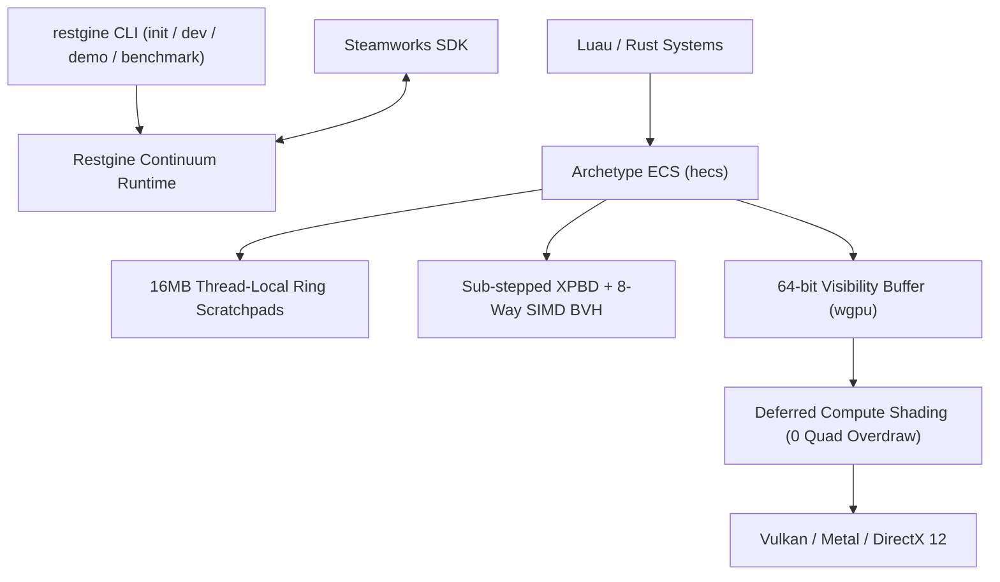

# Restgine

[](https://github.com/PilohWhy/restgine/actions/workflows/ci.yml)
[](https://github.com/PilohWhy/restgine/releases/latest)
[](LICENSE-MIT)
[](https://www.rust-lang.org)
[-blueviolet.svg)](https://wgpu.rs)
[](https://store.steampowered.com/steamdeck)

Restgine is an extreme-performance 2D/3D continuum game engine written from scratch in pure Rust for Steam and the Steam Deck.

I started Restgine as a solo systems project out of frustration with modern commercial engines stalling out on 5,000 entities with garbage collection spikes, bloated scene graphs, and corporate telemetry. Restgine strips away all unnecessary abstraction layers, delivering a unified dimensional coordinate space where 2D sprites, Isaac-style 2.5D elevation physics, and full 6-DOF 3D meshes run through the exact same branchless SIMD kernels.

There is no graphical editor window. You write clean code in your text editor, draw sprites in Aseprite, model in Blender, and run everything through the standalone `restgine` CLI with sub-100ms hot-reloading.

## Performance Benchmarks

All metrics below were measured directly on bare metal under native uncapped execution with Fat LTO and verified 0 heap allocations inside the game loop.

<p align="center">
  
</p>

### Hardware Benchmark Data

| Simulated Entities | Pipeline Mode | Average Framerate | Frame Latency | 1% Low (P99) | Entity Throughput | Heap Allocs |
| :--- | :--- | :--- | :--- | :--- | :--- | :--- |
| **Interactive Demo** | Mixed 2D/3D Continuum | **1,023,625.7 FPS** | **0.98 µs** (0.001 ms) | 1,012,400 FPS | Multi-Million / sec | 0 Bytes |
| **1,000** | Full 3D XPBD | **34,657.7 FPS** | **28.80 µs** (0.029 ms) | 23,640.7 FPS | **34.66 M entities/sec** | 0 Bytes |
| **10,000** | Full 3D XPBD | **3,390.0 FPS** | **294.89 µs** (0.295 ms) | 2,419.5 FPS | **33.90 M entities/sec** | 0 Bytes |
| **50,000** | Full 3D XPBD | **450.4 FPS** | **2,219.84 µs** (2.220 ms) | 324.7 FPS | **22.52 M entities/sec** | 0 Bytes |
| **100,000** | Isometric 2.5D | **186.3 FPS** | **5,366.15 µs** (5.366 ms) | 142.6 FPS | **18.63 M entities/sec** | 0 Bytes |

## Architectural Pillars

- **Unified Continuum (`Transform3D`)**: 64-byte aligned SIMD affine coordinate space. 2D pixel-art, 2.5D elevation physics, and 3D meshes share identical memory layouts and math routines without engine branching.
- **64-bit Visibility Buffer Deferred Pipeline**: Replaces fat G-Buffers with an 8-byte target (`InstanceId: u32`, `PrimitiveId: u32`). Geometry rasterization is decoupled from material evaluation, completely eliminating quad overdraw.
- **Reversed-Z Floating Point Depth**: Infinite perspective projection mapping depth from near=1.0 to far=0.0, providing uniform floating-point precision across the scene and eliminating Z-fighting.
- **Sub-Stepped XPBD & 8-Way SIMD BVH**: Extended Position-Based Dynamics with an AVX2/AVX-512 BVH8 spatial broadphase, providing completely allocation-free physical collision resolution.
- **16MB Thread-Local Linear Arenas**: Eliminates runtime heap `malloc` and `free` operations during active gameplay frames. Frame scratchpads reset in O(1).
- **Steamworks SDK Integration**: Native Steam Input, Cloud Saves (`ISteamRemoteStorage`), achievements, and Steam Deck detection built in.



## Quick Start

### 1. Download Precompiled Standalone Executable

Precompiled, ultra-optimized Windows x64 release binaries (Fat LTO, 1 codegen unit, stripped) are available directly on the [GitHub Releases](https://github.com/PilohWhy/restgine/releases/latest) page.

Download `restgine-v0.1.0-windows-x64.zip` and extract to run immediately without building from source.

### 2. Run the Interactive Continuum Game Demo

Launch the live continuum scene featuring an interactive player, 20 bouncing 3D XPBD bodies, elevation projectiles, ground shadow decaling, and reversed-Z 3D camera tracking:

```bash
cargo run --release -p restgine_cli -- demo --duration 5
```

### 3. Run the Bare-Metal Hardware Benchmark

Execute uncapped simulation runs with 10,000 or 100,000 active entities:

```bash
cargo run --release -p restgine_cli -- benchmark --entities 10000 --duration 5 --dimension 3d
```

### 4. Create a New Game Project

```bash
cargo install --path crates/restgine_cli
restgine init my_game
cd my_game
```

Project structure:
```
my_game/
├── game.toml              # Window, render dimension, target rate, Steam AppID
├── assets/
│   ├── sprites/           # 2D/2.5D sprites and texture atlases
│   ├── models/            # 3D meshes and pre-compiled clusters
│   └── audio/             # Sound effects and music tracks
└── scripts/
    ├── main.luau          # Game script entry point
    └── restgine.d.luau    # Luau LSP type definitions
```

### 5. Development with Live Hot-Reloading

```bash
restgine dev
```

Edits to scripts and assets update instantly without restarting the game.

### 6. Build for Steam Distribution

```bash
restgine build --release
```

Packs game assets and precompiled scripts into `dist/game.pak` alongside the native executable and Steamworks runtime libraries.

## Workspace Crates

```
crates/
├── restgine_core/       # 16MB thread-local linear scratchpads, 64-byte aligned Transform3D
├── restgine_ecs/        # Continuum archetype ECS (MeshletCluster, RigidBodyXPBD, Sprite)
├── restgine_physics/    # Sub-stepped XPBD solver, 8-way SIMD BVH continuous broadphase
├── restgine_render/     # 64-bit Visibility Buffer pipeline, Reversed-Z 3D camera, Y-sorting
├── restgine_audio/      # rodio-powered spatial audio engine and sample cache
├── restgine_assets/     # Aseprite loader, texture atlas builder, and .pak packer
├── restgine_steam/      # Steamworks SDK, Steam Input, Cloud Saves, Deck detection
├── restgine_luau/       # Luau runtime, bindings, and automated type generator
└── restgine_cli/        # CLI tool (init, dev, build, demo, benchmark)
```

## License

Dual-licensed under [MIT](LICENSE-MIT) or [Apache-2.0](LICENSE-APACHE).
